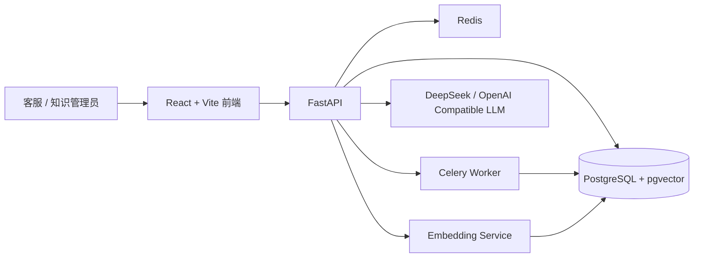

# 保知通

面向互联网保险售后新人客服的知识学习与智能辅助平台。

## 项目背景

互联网保险产品、售后流程和业务规则更新频繁。新人客服需要阅读大量分散的产品资料、操作手册和业务公告，难以快速建立完整的知识框架。

本项目通过结构化知识库、RAG 问答、新知识通知和场景化测验，帮助新人客服快速掌握基础知识，并及时了解业务规则变化。

## 目标用户

- 新人客服
- 资深客服
- 知识管理员
- 客服主管

## 核心功能

1. 新人知识学习路径
2. 基于企业知识库的问答助手
3. 回答引用来源和知识版本
4. 新旧知识版本差异对比
5. 新知识发布与已读确认
6. 根据新知识自动生成测验
7. 学习进度和错题统计
8. 知识审核、发布和失效管理

## 首期业务范围

首期使用虚构的互联网医疗险产品，覆盖：

- 保险基础概念
- 保单查询
- 投保人及被保险人信息变更
- 续期缴费
- 犹豫期退保
- 正常退保
- 理赔申请
- 理赔材料补交
- 投诉与人工升级

## 项目原则

- 不使用真实客户个人信息
- 不使用原公司的内部资料
- 所有业务资料均来自公开信息或虚构数据
- AI 回答必须提供知识来源
- 无可靠来源时不允许编造答案
- 问答只使用当前有效版本的知识

## 当前实现

| 模块 | 已实现能力 |
| --- | --- |
| 知识库 | TXT / Markdown / PDF 上传、解析、分块、向量检索、目录与产品元数据过滤 |
| RAG 问答 | 引用来源、无资料拒答、距离阈值、风险识别、流式回答 |
| 知识更新 | 草稿、发布、已读确认、管理员管理页面 |
| 评测 | 检索召回、引用准确性、风险拦截与 Agent 最终回答评测集 |
| 知识运营 Agent | LangGraph Plan–Execute–Replan、文档状态巡检、更新阅读巡检、LLM 运行质量巡检 |

## 系统架构



## RAG 与安全链路

```text
上传资料 → 文本解析 → 分块 → Embedding → pgvector
客服提问 → 风险识别 / Agent 工具选择 → 混合检索与元数据过滤
→ 距离阈值拒答 → 引用来源 → 流式生成安全答复
```

当前项目对资料不足、投诉争议、拒赔争议、监管与隐私等问题设置了安全边界：资料不足时明确拒答并建议人工确认；不承诺赔付金额、理赔结论或审批结果。

## 知识运营 Agent

知识运营 Agent 用于管理员巡检知识库质量，不对业务数据做写操作。

```text
用户巡检诉求
  → Planner：LLM 通过 Function Calling 生成只读计划
  → Executor：后端白名单执行真实工具
  → Replanner：仅在步骤失败时由 LLM 调整剩余计划
  → Reporter：根据执行结果生成运营报告
```

当前只读工具：

- `get_document_status_summary`：文档处理状态与失败任务
- `get_knowledge_update_summary`：已发布更新与未读情况
- `get_llm_runtime_summary`：过去 24 小时调用量、失败率、延迟与 Token

模型只能生成计划，不能直接执行 SQL 或写操作。所有执行工具经过后端白名单、当前用户 `owner_id` 约束和最多 3 步的循环保护。

## RAG 评测结果

基于 `docs/rag-evals` 中的互联网保险售后测试集，当前基线结果为：

| 指标 | 结果 |
| --- | --- |
| Source Recall@3 | 82.3% |
| Strict Query Recall@3 | 79.3% |
| Citation Precision@3 | 32.2% |
| 无资料问题拒答率 | 61.5% |
| 风险等级准确率 | 100% |
| 人工升级召回率 / 精确率 | 100% / 100% |
| 有据关键事实覆盖率 | 82.3%（51 / 62） |

评测指标用于持续发现检索、引用和安全策略中的薄弱点，不将其表述为生产环境 SLA。

## 本地启动

```bash
git clone https://github.com/liuxinran61/-insurance-knowledge-assistant.git
cd insurance-knowledge-assistant
cp .env.example .env
docker compose up -d --build
```

- 前端开发模式：`cd frontend && npm run dev`
- 前端地址：`http://localhost:5173`
- API 文档：`http://localhost:8001/docs`

首次运行时可先使用 Mock 模式；配置 `LLM_API_KEY`、`LLM_BASE_URL` 与 `LLM_MODEL_NAME` 后可连接兼容 OpenAI API 的模型服务。不要把真实密钥提交到 Git。

## 验证与测试

```bash
# 前端构建
cd frontend && npm run build

# Python 语法检查
python -m compileall -f app

# 后端测试（Docker 开发环境）
docker compose exec api pip install -r requirements-dev.txt
docker compose exec api pytest -q tests/test_knowledge_ops.py
```

`test_knowledge_ops.py` 使用伪 Agent 测试 API 合约，不会请求真实 LLM，也不会消耗 API Key。

## 下一阶段

- 使用 Postgres checkpointer 替换内存 `MemorySaver`，支持 Agent 状态持久化
- 增加知识版本冲突检测、文档失效提醒和运营告警
- 扩展评测集，并降低无资料场景中的误召回
- 增加端到端测试、部署脚本与可公开访问的演示环境
